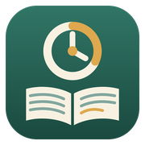

# Sentence by Sentence

A Pomodoro clock that doesn't nag. Set a planned focus time and the clock counts down, then keeps counting past zero, silently, until you stop it. When you stop, it shows how long you actually spent on the task.

Focus time is rewarded with a story: every stretch of focus (one minute by default, adjustable down to seconds) unlocks the next sentence of a novel you load yourself.



## Features

- **Flexible focus:** Pick a planned duration (15, 25, 45, 60 or any number of minutes). At zero the clock turns amber and counts overtime instead of alarming you.
- **Honest totals:** Stopping shows time on task, planned time, and how far over or under you went. Today's sessions are logged with a running total.
- **Breaks:** A 5-minute default break (configurable), quick picks for 10, 15 or 20 minutes, a custom length, or stop the clock entirely.
- **Story rewards:** Load your own stories as **EPUB, HTML or plain text**. AO3 downloads work directly, with tags, summaries and author's notes skipped.
- **Chinese support:** Splits sentences on 。！？…, auto-detects GBK/GB18030 and Big5 text files, and handles full-width indented paragraphs.
- **Keeps your place:** Each story remembers how far you've unlocked and where you were reading. New sentences never scroll the page.
- **Themes:** Sage (follows system light/dark), Parchment, Sakura, Rice Paper, Night Library, Ocean Dusk.
- **Fully offline:** No server, no build step, no account. Everything is saved in your browser's local storage.

## Run it

Open `index.html` in a browser by double-clicking it. That's all.

To host it, enable **GitHub Pages** for the repository (Settings → Pages → Deploy from branch → `main`, root). The app is then available at `https://<you>.github.io/<repo>/`.

> **Your data lives in the browser, per address.** Stories and progress saved under `file://…/index.html` are separate from those saved on your GitHub Pages URL, and separate between browsers. Moving the file to a new folder also counts as a new address.

## Pin it like an app

Windows only pins programs, not documents, so point a shortcut at your browser in app mode:

```
"C:\Program Files\Google\Chrome\Application\chrome.exe" --app="file:///C:/path/to/sentence-by-sentence/index.html"
```

Then set the shortcut's icon to `icons/icon.ico` and choose **Pin to taskbar**. On a Mac, use `icons/icon.icns` (or paste `icons/icon-1024.png` in Get Info).

## Project layout

```
index.html            the whole app: markup, styles and script in one file
vendor/jszip.min.js   JSZip 3.10.1, used to unzip EPUB files (MIT or GPLv3)
icons/                app icon in every size, plus make_icon.py to regenerate them
tests/smoke.mjs       Playwright smoke test (optional)
CLAUDE.md             notes for Claude Code: architecture, storage schema, conventions
```

## Tests

The app needs no tooling. The optional smoke test needs Node 18+:

```
npm install
npx playwright install chromium
npm test
```

It loads the page, unlocks sentences at 1 second each, and checks that the reading position doesn't move during or after a session and is restored after a reload.
